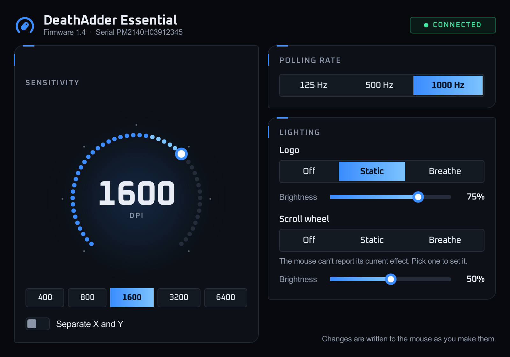

# MouseTune for DeathAdder Essential: settings app for macOS, Windows and Linux



MouseTune is a small, free and open-source app that sets **DPI, polling rate and
LED lighting** on the Razer DeathAdder Essential without Razer Synapse. Settings are
stored on the mouse itself and survive unplugging, so MouseTune does not need
to keep running: open it, change what you want, quit.

**macOS is the primary platform** and the one this project is developed on.
Windows and Linux builds are produced by CI and are community-tested.

## Features

- **DPI** from 100 to 6400 (step 50), optionally with separate X and Y values,
  plus presets (400, 800, 1600, 3200, 6400). Applied when you release the slider.
- **Polling rate:** 125, 500 or 1000 Hz.
- **Lighting** per LED the model actually has: Off, Static or Breathe, and
  brightness 0 to 100 %. The LEDs are green only, so there is no colour picker.
- Reads the current values from the mouse when it connects, and detects plug and
  unplug automatically.
- No background process, no menu bar icon, no telemetry, no network access.

## Supported models

| Model                                  | USB product id | LEDs           |
| -------------------------------------- | -------------- | -------------- |
| DeathAdder Essential                   | `0x006E`       | logo and scroll |
| DeathAdder Essential (White Edition)   | `0x0071`       | logo and scroll |
| DeathAdder Essential (2021)            | `0x0098`       | logo only      |

> **Other DeathAdder models are not supported.** That includes the V2, V2 Mini,
> V3, Elite and every other Razer mouse. MouseTune only sends commands that are
> documented for the three Essential models above and shows "This mouse isn't
> supported" for anything else.

## Install

### macOS

**Disk image (recommended).** Download `MouseTune-<version>-macos-universal.dmg`
from the [latest release](../../releases/latest), open it and drag MouseTune to
Applications. The same release has a `.zip` with the app inside.

MouseTune is signed ad hoc, not with a paid Apple Developer ID, so the first
launch needs one extra step:

1. Open MouseTune. macOS says it cannot verify the app. Click **Done**.
2. Open **System Settings → Privacy & Security**, scroll down and click
   **Open Anyway** next to "MouseTune was blocked".
3. Confirm with your password and open the app again.

**Homebrew** (builds from source, needs a Rust toolchain, which Homebrew installs):

```sh
brew install rodanr/tap/mousetune
cp -R "$(brew --prefix mousetune)/MouseTune.app" /Applications/   # optional
mousetune                                                          # or launch from the terminal
```

#### Input Monitoring permission

macOS only lets apps talk to HID devices after you allow **Input Monitoring**.
On first launch MouseTune asks for it; if the prompt was dismissed, open
**System Settings → Privacy & Security → Input Monitoring**, switch MouseTune
on and reopen the app. Because the app is ad-hoc signed, macOS may ask again
after you update it.

### Windows

Download `MouseTune-<version>-windows-x64.zip` from the releases page, unzip it
and run `MouseTune.exe`. The executable is unsigned, so Windows SmartScreen may
warn: click **More info → Run anyway**.

### Linux

Download `mousetune-<version>-linux-x86_64.tar.gz`, then follow `INSTALL.txt`
inside: install the included udev rule (so your user may access the mouse) and
run `./mousetune`. If the OpenRazer kernel driver is loaded it may own the
device and MouseTune will report that the mouse is in use.

## Build from source

You need a recent stable [Rust](https://rustup.rs) toolchain. On Linux also
install `libudev-dev libfontconfig1-dev libxkbcommon-dev libxkbcommon-x11-dev`.

```sh
cargo run --release --package mousetune   # run the app
cargo test --workspace                    # run the tests (no mouse needed)
./scripts/bundle-macos.sh                 # macOS: universal .app, .zip and .dmg in dist/
cargo run -p mousetune --example snapshots --features snapshots   # render every screen to docs/screenshots/
```

Set `RUST_LOG=mousetune=debug` for detailed logs. The project layout:

| Path                   | What it is                                                           |
| ---------------------- | -------------------------------------------------------------------- |
| `crates/mousetune-core` | Protocol packets, commands and device logic. No I/O, fully unit tested. |
| `crates/mousetune-hid`  | hidapi transport, device discovery, macOS permission check.          |
| `app`                   | The Slint user interface and the device worker thread.               |
| `xtask`                 | `cargo xtask icons` renders `assets/icon.svg` into PNG, icns and ico. |

## Limitations

- No editing of the mouse's on-board DPI stages (the button that cycles DPI
  keeps working, but its stages cannot be changed here).
- No button remapping. On macOS, [Karabiner-Elements](https://karabiner-elements.pqrs.org/)
  does this well.
- The mouse cannot report its current lighting effect, so MouseTune shows the
  last effect you chose (remembered per mouse), or nothing until you pick one.

## Credits

The USB protocol knowledge comes from the [OpenRazer](https://openrazer.github.io/)
project (GPL-2.0-or-later). Thank you to its contributors for documenting these
devices. The UI is built with [Slint](https://slint.dev/), HID access uses
[hidapi](https://github.com/ruabmbua/hidapi-rs), and the display typeface is
[Oxanium](https://github.com/sevmeyer/oxanium) by The Oxanium Project Authors,
bundled under the SIL Open Font License 1.1 (`app/ui/fonts/Oxanium-OFL.txt`).

## License

[GPL-3.0-or-later](LICENSE). See [CONTRIBUTING.md](CONTRIBUTING.md) if you want to help.

---

MouseTune is an independent open-source project and is not affiliated with or endorsed by Razer Inc. Razer and DeathAdder are trademarks of Razer Inc.
